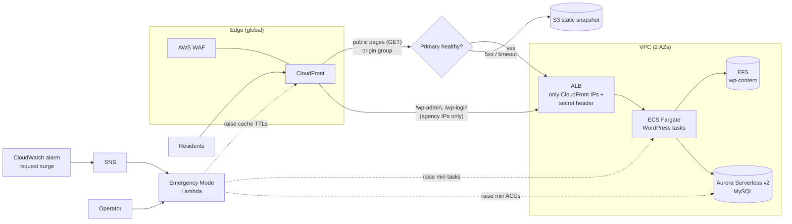

# Storm-Ready Agency Web Platform

A managed CMS hosting platform on AWS built for one scenario that matters
most to a public agency: **the day everyone in the state needs your website
at once.** A hurricane evacuation order goes out, traffic jumps 50× in
minutes, and the site has to stay up — even if the CMS behind it falls over.

Everything is Terraform, deployed through a gated staging → production
pipeline, and torn down when not in use.

## How it maps to the scope

| Requirement | What this platform does |
|---|---|
| **Managed website hosting** | WordPress on ECS Fargate across two AZs behind an ALB; self-heals failed tasks; auto-scales on request rate and CPU |
| **CMS staging and production** | Two isolated environments from the same modules; promotion via GitHub Actions with a smoke test and a human approval gate before prod |
| **Cybersecurity** | AWS WAF (managed rule sets for WordPress, PHP, SQLi, bad inputs, IP reputation), per-IP rate limiting, admin pages locked to agency networks, origin unreachable except through CloudFront, encryption at rest everywhere, DB audit logging, secrets never in code or state |
| **Content delivery** | CloudFront with HTTP/3, Brotli, security headers and edge caching of every public page |
| **Emergency traffic scaling** | **Emergency Mode** (below) plus an automatic static failover copy of the site |

## Architecture



## Emergency Mode

One switch — `scripts/emergency.sh prod on` — or automatically when edge
requests cross a threshold:

1. **ECS**: raises the minimum task count, so capacity is already running
   rather than scaling reactively mid-surge.
2. **Aurora**: raises the minimum ACUs, so the database is warm and never
   paused.
3. **CloudFront**: raises the cache TTL floor so nearly every request is
   answered at the edge, even for pages WordPress marks as uncacheable.

`off` restores the exact baseline Terraform deployed. The alarm can only
turn Emergency Mode **on** — standing down is a human decision.

Independently of Emergency Mode, the public site has a **static failover**:
`scripts/snapshot_site.py` crawls the site into S3, and CloudFront serves
that copy automatically (with a "saved copy" banner) whenever the CMS
returns a 5xx or doesn't respond. Residents never see an error page.

## Repository layout

```
bootstrap/              one-time S3 bucket for Terraform state
envs/staging, envs/prod environment roots (sizing differs, modules don't)
modules/
  platform/             composes everything below for one environment
  network/              VPC, public/app/data subnets, optional NAT, flow logs
  database/             Aurora Serverless v2 MySQL, audit logging
  cms/                  ALB, ECS Fargate WordPress, EFS, auto-scaling
  edge/                 CloudFront, origin failover, S3 snapshot bucket, WAF
  emergency/            Emergency Mode Lambda, state parameter, surge alarm
lambda/emergency_mode/  Lambda source + unit tests
scripts/                snapshot crawler, emergency switch, outage drill, smoke test
loadtest/               k6 surge test (laptop) + fleet/ for the 1M req/min distributed test
docs/DEMO_RUNBOOK.md    step-by-step for recording the demo
```

## Quick start

Prerequisites: Terraform ≥ 1.10, AWS CLI v2 with credentials, Python 3.11+
with `boto3`, [k6](https://k6.io) for load tests.

```bash
# 1. One-time: state bucket
cd bootstrap && terraform init && terraform apply && cd ..

# 2. Configure staging
cp envs/staging/terraform.tfvars.example envs/staging/terraform.tfvars
#    set admin_allowed_cidrs to your IP: curl -s https://checkip.amazonaws.com

# 3. Deploy (~15 min, mostly CloudFront)
cd envs/staging && terraform init && terraform apply

# 4. Install WordPress and create the demo pages (prints the admin login once)
python ../../scripts/seed_demo_content.py --env staging --email you@example.org

# 5. Smoke test, then take the first failover snapshot
python ../../scripts/smoke_test.py --site-url $(terraform output -raw site_url) \
    --alb-dns $(terraform output -raw alb_dns_name)
python ../../scripts/snapshot_site.py --base-url $(terraform output -raw site_url) \
    --bucket $(terraform output -raw failover_bucket)

# 6. Tear down when finished
terraform destroy
```

Through the pipeline instead: set repository secret `AWS_ROLE_ARN` (GitHub
OIDC role) and variable `ADMIN_ALLOWED_CIDRS`, add a required reviewer to the
`production` environment, then run the workflow manually.

## Cost

Built to be switched on for testing and demos, then destroyed.

| State | Approximate cost |
|---|---|
| Staging idle (1 task, Aurora paused, no NAT) | ~$0.10/hour |
| Staging during a 5-minute 50× load test with Emergency Mode on | a few dollars total |
| Prod shape (NAT, 2 tasks, Aurora writer + reader at 0.5 ACU min) | ~$0.35/hour |

The biggest fixed costs are WAF (~$14/month prorated), the NAT gateway
(prod only) and Aurora's minimum capacity (prod only).

## Design decisions

- **Fargate, not EC2.** No servers to patch; a failed task is replaced in
  about a minute. Agencies get managed hosting without OS maintenance.
- **Two request paths at the edge.** Public pages go through a CloudFront
  origin group (cacheable, with S3 failover). CloudFront origin groups only
  support GET/HEAD/OPTIONS, so `/wp-admin`, login, REST API and comments go
  straight to the CMS with caching disabled.
- **Snapshot keys end in `/`.** `/about/` maps to the S3 object
  `site/about/` via `origin_path`, so failover needs no edge function and no
  public bucket. The bucket is private and readable only by this distribution.
- **Origin locked twice.** The ALB security group admits only CloudFront's
  managed prefix list, and the listener returns 403 unless a secret header
  set by CloudFront is present.
- **Terraform sets the baseline; Emergency Mode owns runtime capacity.**
  The scaling and TTL fields Emergency Mode changes are in `ignore_changes`,
  so a routine `terraform apply` during a storm can't undo it. Changing a
  baseline means updating the module input *and* running `emergency off`.
- **Aurora scales to zero in staging.** Staging costs nothing for database
  compute when idle. Health checks hit a static file so the ALB doesn't wait
  on the database waking up.
- **Shared salts and wp-content.** WordPress auth salts live in Secrets
  Manager and wp-content on EFS, so every task behaves identically and
  sessions survive scaling.

## What's real vs. simplified

Real: multi-AZ hosting, auto-scaling, WAF rules, origin lockdown, failover,
Emergency Mode, encrypted storage, audit logs, gated pipeline, policy scan.

Simplified for the demo: everything in the roadmap below. Each item is
also recorded as a `[ROADMAP]` exception in [.checkov.yaml](.checkov.yaml),
so the policy scan stays green without hiding what's deferred.

## Production hardening roadmap

- Separate AWS accounts per environment under AWS Organizations, with
  GuardDuty, Security Hub and Config enabled organization-wide
- Custom domain with HTTPS end to end (CloudFront → ALB → task)
- Access logging: CloudFront, ALB, WAF, S3 → a central log archive account
- Customer-managed KMS keys and 1-year log retention
- AWS Backup plan with cross-region copies; documented and tested RTO/RPO
- Media offload to S3 (instead of EFS) for large media libraries
- Scheduled snapshot refresh after each publish
- Accessibility (WCAG 2.1 AA) checks in the pipeline
- Prod → staging content sync with data scrubbing
